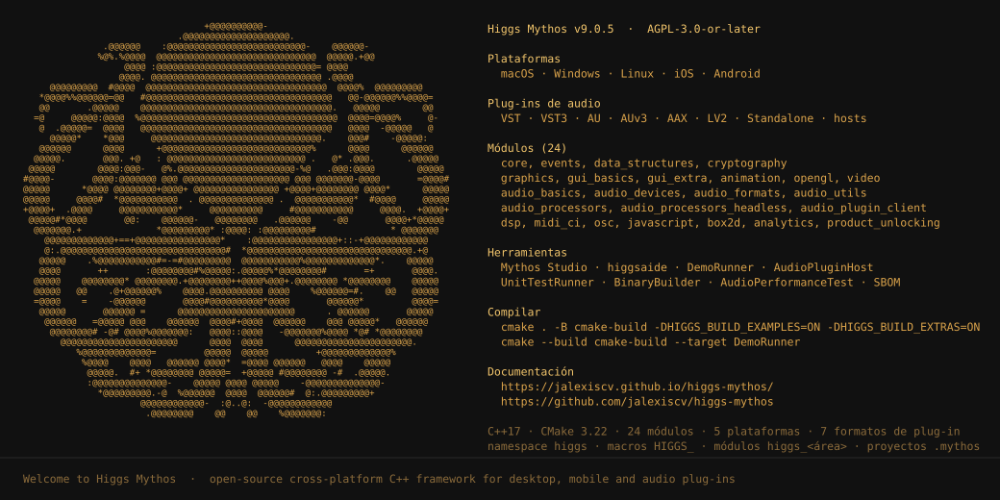

# Higgs Mythos

**Idioma:** [Español](README.md) ·
[English](README.en.md) ·
Português ·
[Français](README.fr.md) ·
[Deutsch](README.de.md) ·
[Italiano](README.it.md) ·
[中文](README.zh-CN.md) ·
[日本語](README.ja.md)

<p align="center"></p>

*A mascote do Higgs Mythos. Versão em texto: [higgs_mythos_mascot.txt](documentacion/contenido/assets/higgs_mythos_mascot.txt).*

Higgs Mythos (abreviado **HIGGS** no código e nos nomes dos módulos) é um
framework de aplicações em C++ de código aberto e multiplataforma para criar
aplicações de desktop e móveis, incluindo plug-ins de áudio nos formatos VST,
VST3, AU, AUv3, AAX e LV2 e os *hosts* que os carregam. O mesmo código-fonte
compila para macOS, Windows, Linux, iOS e Android sem mudar de API: o framework
encapsula o sistema de janelas, o desenho 2D, o áudio e o MIDI de cada sistema
operacional atrás de classes comuns, e o projeto apenas descreve o que precisa
construir.

O framework integra-se em projetos existentes através do CMake ou é usado a
partir do **Mythos Studio**, a sua ferramenta de configuração de projetos, que
exporta projetos para Xcode (macOS e iOS), Visual Studio, Android Studio e
Makefiles de Linux e inclui um editor de código. Foi pensado tanto para
aplicações gerais com interface gráfica, como ferramentas de produtividade ou
utilitários de sistema, quanto para software de áudio profissional que exige
processamento em tempo real, uma gestão de threads rigorosa e compatibilidade
com os formatos de plug-in usados pelas estações de trabalho de áudio.

Higgs Mythos é distribuído sob a licença **AGPL-3.0-or-later**. Os avisos de
copyright dos autores originais são preservados em cada arquivo-fonte, e os
exemplos são publicados sob a licença ISC para que possam ser copiados como
ponto de partida de um projeto próprio sem restrições adicionais.

## Primeiros passos

O framework vive no diretório `modules`. Cada módulo chama-se `higgs_<área>`, o
seu cabeçalho público é `<módulo>/<módulo>.h`, e toda a API de C++ é declarada
no namespace `higgs`. Um módulo é uma unidade autocontida: declara no seu
cabeçalho principal de que outros módulos depende, que cabeçalhos públicos
expõe e que bibliotecas do sistema precisa em cada plataforma, de modo que o
sistema de compilação pode resolver o conjunto mínimo de fontes a compilar para
um determinado projeto.

Para começar basta incluir o cabeçalho do módulo necessário e derivar da classe
correspondente. O exemplo seguinte cria um componente de interface gráfica com
um tamanho inicial de 800 por 600 píxeis; `Component` é a classe base de todo
elemento visual do framework, desde uma janela completa até um botão:

```cpp
#include <higgs_core/higgs_core.h>
#include <higgs_gui_basics/higgs_gui_basics.h>

class MainComponent final : public higgs::Component
{
public:
    MainComponent() { setSize (800, 600); }
};
```

As macros de configuração mantêm o prefixo `HIGGS_` (por exemplo
`HIGGS_MAJOR_VERSION` ou `HIGGS_MODULE_AVAILABLE_higgs_core`), e os números de
versão são definidos em
[higgs_StandardHeader.h](/modules/higgs_core/system/higgs_StandardHeader.h).
As macros `HIGGS_WINDOWS`, `HIGGS_MAC`, `HIGGS_LINUX`, `HIGGS_IOS` e
`HIGGS_ANDROID` identificam a plataforma de destino quando um projeto precisa
de código específico de um sistema. As restantes convenções de nomes
(namespace, funções de CMake, extensão de projeto `.mythos`) estão reunidas em
[docs/higgs-mythos.md](/docs/higgs-mythos.md).

## Módulos

Higgs Mythos organiza-se em vinte e quatro módulos independentes que se
combinam conforme o que cada projeto precisa. Uma aplicação de console pode usar
apenas `higgs_core`; uma aplicação gráfica adiciona `higgs_events`,
`higgs_graphics` e `higgs_gui_basics`; um plug-in de áudio soma os módulos de
áudio e `higgs_audio_plugin_client`. Cada módulo só é compilado quando é
vinculado, de modo que o binário final não arrasta código de áreas que não
utiliza. A tabela seguinte resume o propósito de cada um; a documentação
completa de cada módulo está no site de documentação e nos cabeçalhos Doxygen.

Os módulos agrupam-se em camadas. A base é `higgs_core`, do qual dependem
todos os demais; sobre ele apoiam-se `higgs_events` e `higgs_data_structures`,
que não precisam de interface gráfica e por isso servem também para
ferramentas de console e processos em segundo plano. A camada gráfica
(`higgs_graphics`, `higgs_gui_basics`, `higgs_gui_extra`, `higgs_animation`,
`higgs_opengl`) constrói a interface, e a camada de áudio vai dos dados
(`higgs_audio_basics`) até os dispositivos, os formatos de arquivo, os
processadores e os formatos de plug-in. Cada módulo declara as suas
dependências no seu cabeçalho principal, e o Mythos Studio ou o CMake
resolvem-nas automaticamente ao adicioná-lo a um projeto.

| Módulo | Propósito |
|---|---|
| `higgs_core` | Classes básicas: strings, contêineres, memória, threads, arquivos, rede, XML, JSON, ZIP, tempo e testes unitários. |
| `higgs_events` | Loop de mensagens, temporizadores, mensagens assíncronas, difusores e ouvintes, classe base de aplicação e IPC. |
| `higgs_data_structures` | `ValueTree`, `Value`, `UndoManager` e gestão de preferências. |
| `higgs_cryptography` | RSA, Blowfish, números primos e resumos MD5, SHA-256 e Whirlpool. |
| `higgs_graphics` | Motor 2D: `Graphics`, geometria, cores, fontes, imagens, SVG e efeitos. |
| `higgs_gui_basics` | `Component`, janelas, *widgets*, menus, *layouts*, *look-and-feel* e acessibilidade. |
| `higgs_gui_extra` | Editor de código, `WebBrowserComponent`, seletor de cores, bandeja do sistema e notificações. |
| `higgs_animation` | Animação declarativa com funções de suavização sincronizadas com a tela. |
| `higgs_opengl` | Renderização OpenGL e OpenGL ES dentro de componentes. |
| `higgs_video` | Reprodução de vídeo e captura de câmera. |
| `higgs_audio_basics` | `AudioBuffer`, fontes de áudio, sintetizador, MIDI 1.0, MPE e MIDI 2.0 (UMP). |
| `higgs_audio_devices` | Entrada e saída de áudio e MIDI com CoreAudio, WASAPI, ASIO, ALSA, JACK, Oboe e OpenSL ES. |
| `higgs_audio_formats` | Leitura e escrita de WAV, AIFF, FLAC, Ogg Vorbis, Opus, MP3 e mais. |
| `higgs_audio_processors_headless` | `AudioProcessor`, parâmetros, `AudioProcessorGraph` e hospedagem de plug-ins sem interface. |
| `higgs_audio_processors` | Editores de processador, `AudioProcessorValueTreeState` e varredura de plug-ins. |
| `higgs_audio_plugin_client` | *Wrappers* VST2, VST3, AU, AUv3, AAX, LV2, Unity e Standalone. |
| `higgs_audio_utils` | `AudioAppComponent`, seletores de dispositivo, miniaturas de áudio e teclados MIDI. |
| `higgs_dsp` | Filtros, osciladores, dinâmica, reverberação, convolução, FFT e SIMD. |
| `higgs_midi_ci` | MIDI Capability Inquiry: descoberta, perfis e propriedades. |
| `higgs_osc` | Open Sound Control sobre UDP. |
| `higgs_javascript` | Interpretador de JavaScript baseado em QuickJS. |
| `higgs_box2d` | Motor de física 2D Box2D com renderizador integrado. |
| `higgs_analytics` | Coleta e envio em lote de análises de uso. |
| `higgs_product_unlocking` | Compras integradas e licenças com desbloqueio online. |

## CMake

É necessário CMake 3.22 ou superior. A forma mais direta de verificar que o
ambiente está pronto é compilar as ferramentas e os exemplos incluídos no
repositório: o primeiro comando configura a árvore de compilação no diretório
`cmake-build`, ativando os exemplos e os extras, e o segundo compila
`DemoRunner`, a aplicação que reúne todas as demonstrações do framework:

```bash
cmake . -B cmake-build -DHIGGS_BUILD_EXAMPLES=ON -DHIGGS_BUILD_EXTRAS=ON
cmake --build cmake-build --target DemoRunner
```

No Windows é preciso carregar antes o ambiente do Visual Studio
(`vcvars64.bat`) para que o CMake encontre o compilador MSVC, tanto com Ninja
quanto com MSBuild. No Linux é necessário instalar os pacotes de desenvolvimento
listados em [docs/Linux Dependencies.md](/docs/Linux%20Dependencies.md) antes
de configurar.

A API de CMake usa o prefixo `higgs_`: `higgs_add_gui_app` cria uma aplicação
gráfica, `higgs_add_console_app` uma de console, `higgs_add_plugin` um plug-in
com um alvo por formato, `higgs_add_module` registra um módulo próprio e
`higgs_generate_higgs_header` gera o cabeçalho agregado do projeto. Também
existem `higgs_add_binary_data` para incorporar recursos e
`higgs_set_<kind>_sdk_path` para indicar o caminho dos SDKs VST2, AAX ou ARA.
Os alvos importados chamam-se `higgs::higgs_core`, `higgs::higgs_gui_basics` e
assim por diante, e vinculam-se com `target_link_libraries` como qualquer outra
biblioteca. Para integrar o framework num projeto existente basta
`add_subdirectory` sobre uma cópia do repositório ou `find_package(HIGGS)`
sobre uma instalação. A referência completa está em
[docs/CMake API.md](/docs/CMake%20API.md), e [examples/CMake](/examples/CMake)
contém três projetos mínimos (`GuiApp`, `ConsoleApp` e `AudioPlugin`) pensados
para serem copiados como ponto de partida.

## Mythos Studio

Mythos Studio é o gerador de projetos distribuído em `extras/MythosStudio`.
Guarda a configuração de um projeto num arquivo `.mythos` e, a partir dele,
exporta projetos nativos para cada IDE e plataforma: Xcode para macOS e iOS,
Visual Studio 2019, 2022 e 2026, Makefiles de Linux e Android Studio com
Gradle. Um mesmo arquivo `.mythos` pode ter vários exportadores ao mesmo tempo,
cada um com as suas configurações de Debug e Release, caminhos de SDK e opções
de compilador e vinculador, de modo que o projeto se mantém num único lugar e
os projetos de IDE são regenerados quando os módulos ou os arquivos-fonte
mudam.

A ferramenta inclui uma página inicial com modelos de aplicação e de plug-in,
um gestor de módulos que resolve as dependências, um editor de código com
realce de sintaxe e uma interface de linha de comandos (`--resave`,
`--set-version`, `--encode-binary`, `--create-project-from-pip`, entre
outras) para automatizar tarefas sem abrir a janela. A sua companheira
`higgsaide` gera a partir do terminal os dados binários e demais recursos que
os projetos incorporam. O Android só é suportado através do Mythos Studio, já
que a API de CMake não gera projetos para essa plataforma.

O Mythos Studio compila-se a partir de `extras/MythosStudio/Builds` (projetos
de Visual Studio, Xcode ou Makefile de Linux) ou através do CMake com
`-DHIGGS_BUILD_EXTRAS=ON` e o alvo `MythosStudio`. Também há executáveis
pré-compilados, sem assinatura, para Windows x64, macOS universal e Linux x64,
gerados pelo fluxo do GitHub Actions `HIGGS Mythos Studio Build` e descarregáveis
como *artifacts* de cada execução.

## Ferramentas e exemplos

Além do Mythos Studio, o diretório `extras` reúne as ferramentas que acompanham
o framework e que se compilam com `-DHIGGS_BUILD_EXTRAS=ON`. `AudioPluginHost`
é um *host* de plug-ins completo que varre os formatos instalados no sistema,
liga-os num grafo de processadores e permite testar um plug-in próprio sem
depender de uma estação de trabalho comercial. `UnitTestRunner` executa os
testes unitários que cada módulo declara com a classe `UnitTest`; admite
filtrar por categoria ou por nome e é a referência de verificação do projeto.
`BinaryBuilder` converte arquivos em dados incorporados, `AudioPerformanceTest`
mede o desempenho do processamento de áudio em tempo real,
`NetworkGraphicsDemo` demonstra o desenho distribuído entre várias máquinas e
`SBOM` gera e verifica o inventário de dependências de terceiros.

O diretório `examples` contém demonstrações completas e compiláveis da maioria
das funcionalidades, organizadas por área: `GUI`, `Audio`, `DSP`, `Plugins`,
`Utilities` e `Assets`. Todas são PIP: projetos completos contidos num único
arquivo de cabeçalho que começa com um bloco de metadados (nome, dependências,
tipo e classe principal), e que o `DemoRunner` carrega e mostra junto ao seu
código-fonte, de modo que é possível ler a implementação de cada demo enquanto
ela é executada. `examples/CMake` contém os três projetos mínimos já
mencionados, e `examples/Plugins` inclui plug-ins completos (sintetizadores, um
sampler, um arpejador, um *noise gate*, um *host* dentro de um plug-in e um
exemplo de ARA) que servem de referência para o ciclo de vida completo de um
`AudioProcessor`.

## Documentação

O guia de usuário completo em espanhol é publicado em
<https://jalexiscv.github.io/higgs-mythos/> e as suas fontes vivem em
[documentacion](/documentacion). Cobre os primeiros passos (instalação,
primeira aplicação e primeiro plug-in), os conceitos do framework
(arquitetura, loop de mensagens, threads, memória e convenções), um guia por
cada área (interface gráfica, gráficos, áudio, MIDI, DSP, plug-ins,
hospedagem, OpenGL, vídeo, web, acessibilidade, localização), uma página de
referência por módulo, a API de CMake, as ferramentas e as notas do projeto
(mudanças incompatíveis, licença, segurança e glossário). O site é construído
com MkDocs e implantado automaticamente no GitHub Pages quando a documentação,
os módulos ou os exemplos mudam no ramo `main`; as páginas de referência são
regeneradas a partir da árvore de fontes em cada implantação.

A documentação da API é gerada diretamente a partir dos comentários Doxygen
dos cabeçalhos dos módulos, e o código-fonte é a documentação mais completa e
atualizada que existe. O cabeçalho principal de cada módulo,
`higgs_<módulo>/higgs_<módulo>.h`, enumera os seus cabeçalhos públicos e as
suas dependências; o formato de módulo está descrito em
[docs/Higgs Mythos Module Format.md](/docs/Higgs%20Mythos%20Module%20Format.md).
Para localizar uma classe, basta procurar a sua declaração nos cabeçalhos e ler
o bloco de comentário situado acima:

```bash
grep -rlE "^\s*(class|struct)\s+(HIGGS_API\s+)?AudioProcessorValueTreeState\b" modules
```

[BREAKING_CHANGES.md](BREAKING_CHANGES.md) descreve, versão por versão, o que
mudou e como atualizar o código; [CHANGE_LIST.md](CHANGE_LIST.md) resume os
destaques de cada versão, e [docs/README.md](/docs/README.md) é o índice da
documentação técnica do repositório (formato de módulos, API de CMake,
identidade do framework e protocolos de trabalho).

## Requisitos mínimos do sistema

Higgs Mythos exige C++17 como padrão mínimo porque os seus cabeçalhos públicos
usam recursos desse padrão (cada módulo o declara no campo
`minimumCppStandard` do seu cabeçalho principal); quando se ativa
`HIGGS_USE_WINDOWS_MIDI_SERVICES` o projeto deve ser compilado com C++20, já
que o SDK do Windows MIDI Services o exige. As versões de compilador indicadas
a seguir são as mais antigas que são testadas: versões mais recentes de Xcode,
Visual Studio, GCC e Clang funcionam sem alterações. No Linux, além do
compilador, são necessárias as bibliotecas de desenvolvimento de X11,
FreeType, ALSA e outras listadas em
[docs/Linux Dependencies.md](/docs/Linux%20Dependencies.md); no Android o
projeto é construído com Gradle e o NDK a partir do Android Studio, através dos
projetos que o Mythos Studio exporta. As duas listas seguintes distinguem a
máquina de desenvolvimento da máquina de execução: a primeira indica com que se
compila, a segunda onde o resultado é executado. Por exemplo, um plug-in para
Windows em Arm64 compila-se a partir do Visual Studio em qualquer máquina
Windows compatível, e as aplicações de iOS e Android compilam-se a partir do
macOS ou de um desktop com Android Studio, respectivamente.

### Compilar projetos HIGGS

Esta lista reúne, por plataforma de desenvolvimento, a ferramenta mínima com a
qual o framework se compila: o IDE ou o compilador e a versão do sistema
operacional da máquina de desenvolvimento. No macOS e no iOS usa-se o Xcode,
que inclui o Clang e os SDKs da Apple; a versão mínima do sistema depende de a
máquina ser Intel ou Apple Silicon, porque o Xcode 12.4 exige sistemas
diferentes em cada arquitetura. No Windows usa-se o Visual Studio com a carga
de trabalho de desktop em C++ e o SDK do Windows 10, tanto a partir do IDE
quanto da linha de comandos após carregar `vcvars64.bat`. No Linux serve
qualquer GCC ou Clang moderno junto com as bibliotecas de desenvolvimento do
sistema, e os Makefiles que o Mythos Studio exporta ou os projetos de CMake
compilam-se a partir do terminal. No Android são necessários o Android Studio,
o plugin do Gradle e o NDK, com os quais se compilam os projetos que o Mythos
Studio exporta; a máquina anfitriã pode ser Windows, macOS ou Linux. As
versões indicadas são mínimos testados, não recomendações: as versões atuais
de cada ferramenta funcionam sem alterações.

- __Padrão de C++__: 17 (20 quando se compila com `HIGGS_USE_WINDOWS_MIDI_SERVICES` ativado)
- __macOS/iOS__: Xcode 12.4 (macOS 10.15.4 em Intel, macOS 11.0 em Apple Silicon)
- __Windows__: Visual Studio 2019 (Windows 10 versão 1607)
- __Linux__: g++ 7.0 ou Clang 6.0 (ver [docs/Linux Dependencies.md](/docs/Linux%20Dependencies.md))
- __Android__: Android Studio Narwhal 3 (2025.1.3) com Android Gradle plugin 8.13.2
  e NDK 28 em Windows, macOS ou Linux

### Plataformas de destino

Os valores seguintes são as versões mínimas do sistema operacional em que as
aplicações e os plug-ins compilados com o framework são executados, e as
arquiteturas de processador para as quais se geram binários. No macOS e no
Windows é habitual produzir binários universais ou várias arquiteturas a
partir do mesmo projeto; no Android, o Mythos Studio gera os ABI selecionados
num único pacote. Escolher uma versão mínima mais alta para um projeto
concreto (por exemplo macOS 11 em vez de 10.11) é possível a partir dos ajustes
do exportador no Mythos Studio ou com as variáveis habituais do CMake, e
permite usar APIs mais recentes do sistema; descer abaixo dos valores da lista
não é suportado, porque o framework usa APIs que não existem em versões
anteriores. No iOS, o simulador em x86_64 permite testar em Macs com
processador Intel, e os dispositivos físicos usam Arm64 ou Arm64e. No Android
convém incluir pelo menos arm64-v8a, a arquitetura de todos os dispositivos
atuais, e adicionar as demais apenas quando o público-alvo o justificar,
porque cada ABI adicional aumenta o tamanho do pacote.

- __macOS__: macOS 10.11 (x86_64, Arm64)
- __Windows__: Windows 10 versão 1607 (x86_64, x86, Arm64, Arm64EC)
- __Linux__: distribuições principais (x86_64, Arm64/aarch64)
- __iOS__: iOS 12 (Arm64, Arm64e, simulador x86_64)
- __Android__: Android 7 - Nougat (API Level 24) (arm64-v8a, armeabi-v7a, x86_64, x86)

## Contribuir

As contribuições são recebidas através do GitHub. Os pedidos de funcionalidades
e as perguntas gerais vão na seção *Discussions* do repositório; os erros
reproduzíveis são registrados como *issues* indicando a versão do Higgs Mythos,
os módulos afetados, a plataforma e uma reprodução mínima, usando os modelos de
`.github/ISSUE_TEMPLATE` sempre que possível. As vulnerabilidades de segurança
nunca são publicadas num *issue*: são comunicadas de forma privada pelo canal
descrito em [SECURITY.md](SECURITY.md).

Cada *pull request* deve concentrar-se numa única mudança e descrever o que
corrige ou o que adiciona. Antes de abri-lo é preciso compilar os alvos
afetados e executar os testes unitários com `UnitTestRunner`. O código, os
comentários e as mensagens de commit são escritos em inglês com o formato
`area: resumo`. Ao enviar uma contribuição aceita-se licenciá-la sob os mesmos
termos que o projeto (AGPL-3.0-or-later) e confirma-se ser autor do código ou
ter o direito de enviá-lo; não se admite código copiado de binários
proprietários nem de fontes com licença incompatível com a AGPL. O guia
completo está em [.github/contributing.md](.github/contributing.md), e
[CODE_OF_CONDUCT.md](CODE_OF_CONDUCT.md) estabelece as normas de convivência da
comunidade.

## Licença

Higgs Mythos é software livre: pode ser redistribuído e modificado sob os
termos da GNU Affero General Public License publicada pela Free Software
Foundation, na sua versão 3 ou, à escolha do usuário, qualquer versão
posterior (**AGPL-3.0-or-later**). O texto completo e as notas sobre a sua
aplicação estão em [LICENSE.md](LICENSE.md). A AGPL é uma licença *copyleft*:
qualquer obra derivada que seja distribuída, ou oferecida aos usuários através
de uma rede, deve ser publicada sob a mesma licença e com o seu código-fonte
disponível. Isso inclui as aplicações e os plug-ins que vinculam o framework.

Higgs Mythos deriva de uma base de código aberto anterior cuja marca foi
retirada por completo dos nomes, dos módulos, das macros e dos recursos. Os
avisos de copyright dos autores originais são preservados intactos no
cabeçalho de cada arquivo-fonte, como a licença exige, e não devem ser editados
nem removidos. Os exemplos de `examples` são publicados sob a licença ISC,
muito mais permissiva, para que possam ser copiados como base de um projeto
novo. O inventário de dependências de terceiros e as suas licenças está em
[HiggsMythos.spdx.json](HiggsMythos.spdx.json), em formato SPDX, e os SDKs de
plug-ins (VST3, AAX, ARA, LV2) são utilizados sob as suas próprias licenças e
acordos sem serem incluídos no repositório quando estas não o permitem.

## Plug-ins AAX

Os plug-ins AAX devem ser assinados digitalmente com as ferramentas de
assinatura da PACE Anti-Piracy antes de poderem ser executados nas versões
comerciais do Pro Tools. A Avid fornece estas ferramentas gratuitamente. Antes
de obtê-las é necessário usar uma compilação especial do Pro Tools, chamada
Pro Tools Developer, para testar os plug-ins sem assinatura. Os passos para
obter o Pro Tools Developer são:

1. Registrar-se como desenvolvedor AAX em <https://developer.avid.com/aax/>.
2. Solicitar um código de ativação do Pro Tools Developer Bundle escrevendo
   para <devauth@avid.com>.
3. Descarregar a última compilação do Pro Tools Developer a partir da conta de
   desenvolvedor da Avid.

Quando os plug-ins tiverem sido testados e depurados no Pro Tools Developer e
estiverem prontos para serem assinados, é preciso escrever para
<audiosdk@avid.com> com o assunto "PACE Eden Signing Tools Request". A
mensagem deve incluir uma descrição de cada plug-in junto com uma gravação de
tela que mostre o plug-in em execução no Pro Tools Developer, com áudio se
possível, além das seguintes informações:

- Nome da empresa
- Nome completo do administrador
- Número de telefone

Uma vez enviado o pedido, a PACE Anti-Piracy entrará em contato diretamente
com informações sobre a assinatura dos plug-ins. O alvo AAX de
`higgs_add_plugin` gera o pacote `.aaxplugin` pronto para assinar; o caminho do
SDK AAX indica-se com `higgs_set_aax_sdk_path` antes de declarar o plug-in.
