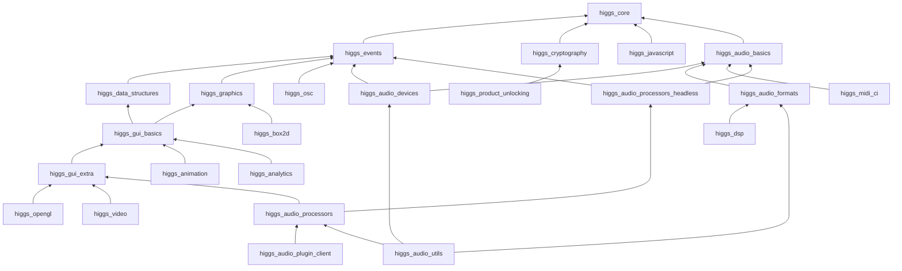
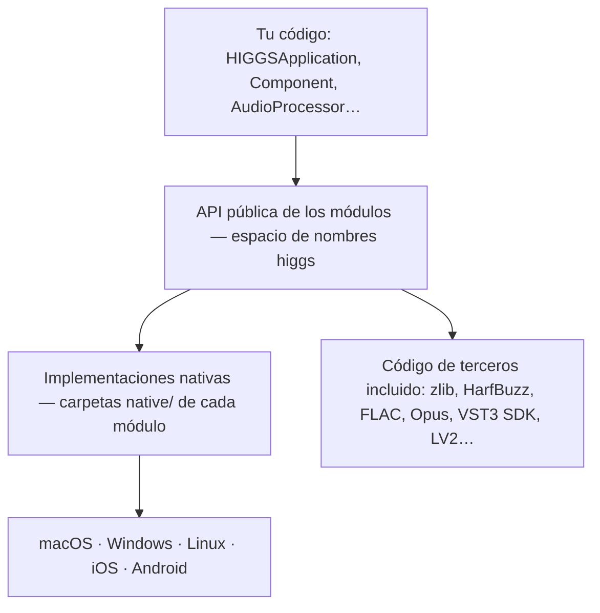

# Arquitectura del framework

Higgs Mythos está formado por **24 módulos** que viven en `modules/`. Cada módulo es una carpeta
autocontenida con una cabecera principal (`higgs_<área>/higgs_<área>.h`), uno o pocos archivos
`.cpp` que compilan todo su código, y un bloque de declaración que indica sus dependencias y los
frameworks o bibliotecas del sistema que necesita.

## Módulos por capas

Cada flecha va de un módulo a aquello de lo que depende directamente. Las dependencias son
transitivas: si enlazas `higgs::higgs_audio_utils` obtienes también `higgs_audio_processors`,
`higgs_gui_extra`, `higgs_gui_basics`, `higgs_graphics`, `higgs_audio_formats`,
`higgs_audio_devices`, `higgs_audio_basics`, `higgs_events`, `higgs_data_structures` y
`higgs_core`.

## Grupos funcionales

| Grupo | Módulos | Para qué sirven |
|---|---|---|
| Núcleo | `higgs_core`, `higgs_events`, `higgs_data_structures`, `higgs_cryptography` | Texto, contenedores, memoria, hilos, archivos, red, XML/JSON, ZIP, bucle de mensajes, `ValueTree`, deshacer/rehacer, criptografía |
| Gráficos e interfaz | `higgs_graphics`, `higgs_gui_basics`, `higgs_gui_extra`, `higgs_animation`, `higgs_opengl`, `higgs_video` | Dibujo 2D, fuentes, imágenes, componentes, ventanas, widgets, editor de código, navegador web, animación, OpenGL, vídeo y cámara |
| Audio | `higgs_audio_basics`, `higgs_audio_devices`, `higgs_audio_formats`, `higgs_audio_utils`, `higgs_dsp`, `higgs_midi_ci` | Búferes, MIDI/MPE/UMP, síntesis, dispositivos de audio y MIDI, códecs, DSP, MIDI-CI |
| Plug-ins | `higgs_audio_processors_headless`, `higgs_audio_processors`, `higgs_audio_plugin_client` | `AudioProcessor`, parámetros, grafo de procesamiento, alojamiento de plug-ins y *wrappers* de formatos |
| Otros | `higgs_osc`, `higgs_javascript`, `higgs_box2d`, `higgs_analytics`, `higgs_product_unlocking` | OSC, intérprete de JavaScript, física 2D, analítica, compras integradas y desbloqueo de productos |

La [referencia de módulos](../modulos/index.md) documenta cada uno en detalle.

## Cómo se compila un módulo

Cada módulo se compila como una o pocas *unidades de compilación*: el archivo
`higgs_<área>.cpp` incluye internamente todos los `.cpp` de sus subcarpetas. Algunos módulos
tienen variantes por plataforma (por ejemplo `higgs_core.mm` en macOS/iOS) o archivos adicionales
para código de terceros (por ejemplo `higgs_core_zlib.c`). Esto hace que:

- Añadir un módulo a un proyecto sea trivial, tanto con CMake como con Mythos Studio.
- Los módulos sean **reubicables**: todas las inclusiones internas usan rutas relativas.
- Las opciones de configuración (`HIGGS_USE_CURL`, `HIGGS_ASIO`…) se apliquen como definiciones
  de preprocesador del target que incluye el módulo.

Con CMake, `higgs_add_module` crea para cada módulo una biblioteca `INTERFACE` cuyo contenido se
compila **dentro de cada target que la enlaza**. Por eso los módulos deben enlazarse con
visibilidad `PRIVATE` (véase [higgs_add_module](../compilacion/cmake-api.md#higgs_add_module)).

## De la aplicación al sistema operativo

Las carpetas `native/` contienen el código específico de cada plataforma (CoreAudio, WASAPI,
ALSA, Oboe, Direct2D, X11, UIKit…). Tu código no las usa directamente: el API público es el mismo
en todas las plataformas, y las diferencias se expresan con macros como `HIGGS_MAC`,
`HIGGS_WINDOWS`, `HIGGS_LINUX`, `HIGGS_IOS` o `HIGGS_ANDROID`.

## Tipos de proyecto

| Tipo | Cómo se crea | Punto de entrada |
|---|---|---|
| Aplicación gráfica | `higgs_add_gui_app` | Clase derivada de `HIGGSApplication` + `START_HIGGS_APPLICATION` |
| Aplicación de consola | `higgs_add_console_app` | Tu propia función `main` |
| Plug-in de audio | `higgs_add_plugin` | Función `createPluginFilter()` que devuelve tu `AudioProcessor` |
| Biblioteca | `add_library` + módulos enlazados | — |
| PIP | `higgs_add_pip` | La clase indicada en `mainClass` |
