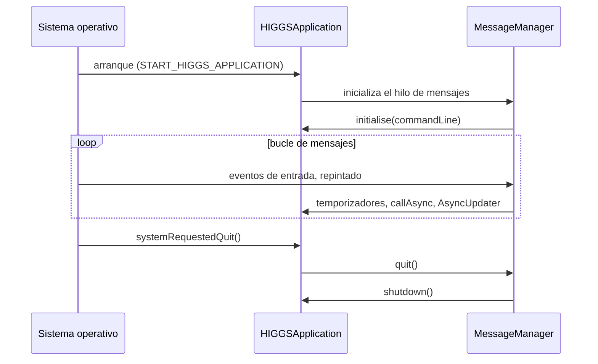

# Bucle de mensajes y eventos

Las aplicaciones de Higgs Mythos se basan en un **hilo de mensajes** (*message thread*): un único
hilo que procesa los eventos del sistema operativo (ratón, teclado, repintados), los
temporizadores y los mensajes que envía tu propio código. El módulo `higgs_events` implementa
esta infraestructura.

## El hilo de mensajes

- En una aplicación gráfica, el hilo de mensajes es el hilo principal; `START_HIGGS_APPLICATION`
  lo arranca y llama a `initialise()` cuando está listo.
- En un plug-in, el hilo de mensajes es el hilo de interfaz del host.
- Toda operación sobre componentes (crear, mover, repintar) debe hacerse **en el hilo de
  mensajes**.

`higgs::MessageManager` es el objeto que gestiona la cola:

```cpp
auto* mm = higgs::MessageManager::getInstance();

if (mm->isThisTheMessageThread())
    actualizarInterfaz();
```

La macro `HIGGS_ASSERT_MESSAGE_THREAD` lanza una aserción en depuración si se llama desde otro
hilo; úsala en tus métodos que solo deben ejecutarse en el hilo de mensajes.

## Ejecutar código en el hilo de mensajes

Desde cualquier hilo puedes encolar una función para que se ejecute más tarde en el hilo de
mensajes:

```cpp
higgs::MessageManager::callAsync ([safe = higgs::Component::SafePointer<MiComponente> (this)]
{
    if (safe != nullptr)
        safe->repaint();
});
```

`Component::SafePointer` se vuelve nulo si el componente se destruye antes de que la función se
ejecute, lo que evita accesos a memoria liberada.

Si necesitas esperar el resultado, `MessageManager::callFunctionOnMessageThread()` bloquea hasta
que la función se ejecute, y `MessageManagerLock` permite tomar temporalmente el control del hilo
de mensajes desde otro hilo. Úsalos con cuidado: un bloqueo desde el hilo de audio puede provocar
cortes.

## Temporizadores

```cpp
class Reloj final : public higgs::Component,
                    private higgs::Timer
{
public:
    Reloj()            { startTimerHz (30); }        // 30 veces por segundo
    ~Reloj() override  { stopTimer(); }

private:
    void timerCallback() override { repaint(); }     // siempre en el hilo de mensajes
};
```

| Clase | Precisión | Hilo de la llamada |
|---|---|---|
| `Timer` | Milisegundos; puede retrasarse si el hilo de mensajes está ocupado | Hilo de mensajes |
| `HighResolutionTimer` | Mayor precisión | Hilo propio de alta prioridad |
| `MultiTimer` | Varios temporizadores identificados por un `int` en un mismo objeto | Hilo de mensajes |
| `VBlankAttachment` (`higgs_gui_basics`) | Sincronizado con el refresco de la pantalla | Hilo de mensajes |

## Mensajes asíncronos

`AsyncUpdater` agrupa peticiones: puedes llamar a `triggerAsyncUpdate()` muchas veces desde
cualquier hilo y `handleAsyncUpdate()` se ejecutará **una sola vez** en el hilo de mensajes.

```cpp
class Medidor final : public higgs::Component,
                      private higgs::AsyncUpdater
{
public:
    void nuevoValor (float v)          // puede llamarse desde otro hilo
    {
        valor.store (v);
        triggerAsyncUpdate();
    }

private:
    void handleAsyncUpdate() override  { repaint(); }

    std::atomic<float> valor { 0.0f };
};
```

!!! warning "AsyncUpdater y audio"
    `triggerAsyncUpdate()` envía un mensaje al sistema operativo y no garantiza tiempo real. En el
    hilo de audio es preferible escribir en una variable atómica o en una cola sin bloqueos y
    leerla desde un `Timer`.

## Difusores y oyentes

El patrón *broadcaster/listener* está presente en todo el framework:

| Difusor | Oyente | Uso |
|---|---|---|
| `ChangeBroadcaster` | `ChangeListener::changeListenerCallback()` | Notificar «algo cambió» de forma asíncrona y agrupada |
| `ActionBroadcaster` | `ActionListener::actionListenerCallback (const String&)` | Enviar mensajes de texto |
| `ListenerList<T>` | Tu propia interfaz | Mantener listas de oyentes de forma segura frente a eliminaciones durante la notificación |
| `Value` / `ValueTree` | `Value::Listener`, `ValueTree::Listener` | Observar datos del modelo (véase [Modelo de datos](../guias/datos.md)) |

```cpp
class Modelo : public higgs::ChangeBroadcaster
{
public:
    void setNombre (const higgs::String& n) { nombre = n; sendChangeMessage(); }
    higgs::String nombre;
};

class Vista final : public higgs::Component,
                    private higgs::ChangeListener
{
public:
    explicit Vista (Modelo& m) : modelo (m)   { modelo.addChangeListener (this); }
    ~Vista() override                          { modelo.removeChangeListener (this); }

private:
    void changeListenerCallback (higgs::ChangeBroadcaster*) override { repaint(); }
    Modelo& modelo;
};
```

## Comunicación entre procesos

`higgs_events` también incluye:

- `InterprocessConnection` e `InterprocessConnectionServer`: mensajes entre procesos mediante
  sockets o tuberías con nombre.
- `ChildProcessCoordinator` y `ChildProcessWorker`: lanzar un proceso hijo y comunicarse con él,
  detectando si alguno de los dos deja de responder.
- `NetworkServiceDiscovery`: anunciar y descubrir servicios en la red local.

## Ciclo de vida de una aplicación



En móviles también recibirás `suspended()` y `resumed()` cuando la aplicación pase a segundo
plano o vuelva al primero.
