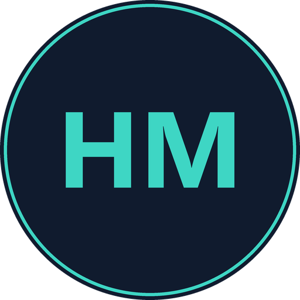

# Higgs Mythos


<div class="hm-hero" markdown>

<p markdown>**Higgs Mythos** (abreviado **HIGGS** en el código y en los nombres de los módulos) es un
framework de aplicaciones en C++, de código abierto y multiplataforma, para crear aplicaciones
de escritorio y móviles, plug-ins de audio en los formatos **VST, VST3, AU, AUv3, AAX y LV2**, y
también anfitriones (hosts) de plug-ins.</p>
</div>

Con el mismo código fuente puedes compilar para **macOS, Windows, Linux, iOS y Android**. Puedes
integrarlo en un proyecto existente mediante **CMake** o usar **Mythos Studio**, la herramienta de
configuración de proyectos que exporta proyectos para Xcode, Visual Studio, Android Studio y
Makefiles de Linux, e incluye un editor de código.

!!! info "Versión documentada"
    Esta documentación corresponde a **Higgs Mythos 9.0.5** (los números de versión se definen en
    `modules/higgs_core/system/higgs_StandardHeader.h`). La licencia del framework es
    **AGPL-3.0-or-later**; los ejemplos se distribuyen bajo licencia **ISC**.

## ¿Qué puedes construir?

| Tipo de proyecto | Función de CMake | Módulo principal |
|---|---|---|
| Aplicación con interfaz gráfica | `higgs_add_gui_app` | `higgs_gui_basics` / `higgs_gui_extra` |
| Aplicación de consola | `higgs_add_console_app` | `higgs_core` |
| Plug-in de audio (VST3, AU, AUv3, AAX, LV2, Unity, Standalone) | `higgs_add_plugin` | `higgs_audio_plugin_client` |
| Anfitrión de plug-ins | `higgs_add_gui_app` + `PLUGINHOST_AU` | `higgs_audio_processors` |
| Módulo reutilizable | `higgs_add_module` | — |
| Prototipo rápido de un solo archivo (PIP) | `higgs_add_pip` | según sus dependencias |

## Un vistazo al código

Todo el API está en el espacio de nombres `higgs`, y cada módulo se incluye con su cabecera
principal:

```cpp
#include <higgs_core/higgs_core.h>
#include <higgs_gui_basics/higgs_gui_basics.h>

class MainComponent final : public higgs::Component
{
public:
    MainComponent() { setSize (800, 600); }

    void paint (higgs::Graphics& g) override
    {
        g.fillAll (higgs::Colours::black);
        g.setColour (higgs::Colours::white);
        g.setFont (higgs::FontOptions (20.0f));
        g.drawText ("Hola, Higgs Mythos", getLocalBounds(), higgs::Justification::centred);
    }
};
```

Y para compilar los ejemplos y herramientas incluidos en el repositorio:

```bash
git clone https://github.com/jalexiscv/higgs-mythos.git
cd higgs-mythos
cmake . -B cmake-build -DHIGGS_BUILD_EXAMPLES=ON -DHIGGS_BUILD_EXTRAS=ON
cmake --build cmake-build --target DemoRunner
```

## Cómo está organizada esta documentación

<div class="grid cards" markdown>

-   :material-rocket-launch: **[Primeros pasos](primeros-pasos/index.md)**

    ---

    Requisitos, instalación y tus primeros proyectos: una aplicación gráfica, una de consola y
    un plug-in de audio.

-   :material-lightbulb-on: **[Conceptos](conceptos/index.md)**

    ---

    La arquitectura modular, las convenciones de nombres, el bucle de mensajes, los hilos y las
    clases básicas del núcleo.

-   :material-book-open-variant: **[Guías](guias/index.md)**

    ---

    Interfaz gráfica, gráficos 2D, audio, MIDI, DSP, plug-ins, hosting, ARA, datos, red,
    WebView, OpenGL, animación, accesibilidad y más.

-   :material-hammer-wrench: **[Compilación](compilacion/index.md)**

    ---

    La referencia completa del API de CMake, la compilación por plataforma, las opciones de
    configuración y el formato de los módulos.

-   :material-tools: **[Herramientas](herramientas/index.md)**

    ---

    Mythos Studio, `higgsaide`, AudioPluginHost, UnitTestRunner y el resto de utilidades de
    `extras`.

-   :material-view-module: **[Módulos](modulos/index.md)**

    ---

    Ficha de cada uno de los 24 módulos: dependencias, frameworks del sistema, opciones de
    configuración y catálogo de clases públicas.

-   :material-play-box-multiple: **[Ejemplos](ejemplos/index.md)**

    ---

    Catálogo de los más de 80 ejemplos y demos incluidos, agrupados por área.

-   :material-scale-balance: **[Proyecto](proyecto/index.md)**

    ---

    Novedades, cambios incompatibles, licencia, dependencias de terceros, contribución y
    seguridad.

</div>

## Estructura del repositorio

```text
higgs-mythos/
├── modules/          # El framework: un directorio por módulo higgs_<área>
├── examples/         # Demos y proyectos de ejemplo (licencia ISC)
│   ├── CMake/        # Plantillas mínimas: GuiApp, ConsoleApp, AudioPlugin
│   └── DemoRunner/   # Aplicación que reúne todas las demos
├── extras/           # Herramientas: Mythos Studio, AudioPluginHost, UnitTestRunner…
│   └── Build/        # Soporte de CMake y la herramienta higgsaide
├── docs/             # Documentación técnica original (en inglés) y configuración de Doxygen
├── documentacion/    # Esta documentación en español (MkDocs)
├── CMakeLists.txt    # Proyecto CMake raíz
├── BREAKING_CHANGES.md
├── CHANGE_LIST.md
├── HiggsMythos.spdx.json  # Inventario SPDX de dependencias de terceros
└── LICENSE.md
```
